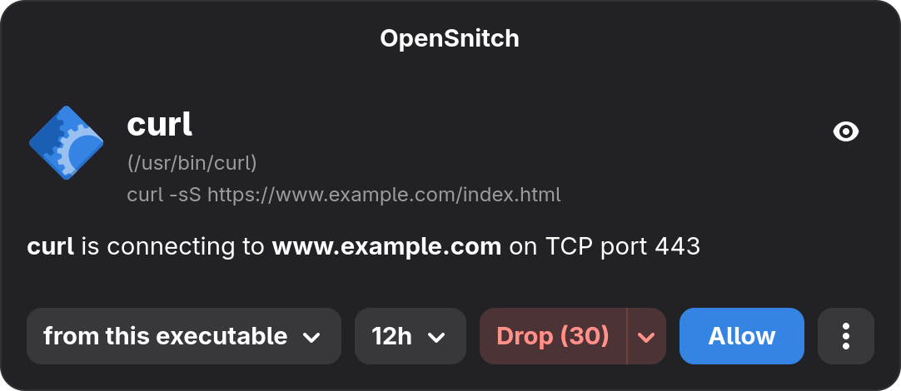

# snitch

[](https://github.com/jeronimoalbi/snitch/actions/workflows/test.yml)
[](https://github.com/jeronimoalbi/snitch/actions/workflows/audit.yml)
[](LICENSE)

A GTK4 prompt for [OpenSnitch](https://github.com/evilsocket/opensnitch).

<p align="center">
  
</p>

It reads the defaults you already saved in the official Qt UI.

> Snitch is an unofficial project and isn't affiliated with OpenSnitch.

## What you need

- The OpenSnitch daemon, `opensnitchd`, running as a service.
- GTK 4 and libadwaita, on Wayland or X11.
- Only one prompt program can talk to the daemon at a time, so stop
  `opensnitch-ui` before you start snitch.

## Install

### Arch Linux

It needs `gtk4`, `libadwaita`, `gtk4-layer-shell` and `opensnitch` to run.

The package in `contrib/arch` builds a tagged release and installs the program and
its systemd service:

```sh
cd contrib/arch
makepkg -si
```
To install the **committed** `HEAD` as `snitch-git`:

```sh
cd contrib/arch/local
makepkg -si
```

### Build from source

You need Rust 1.92 or newer, GTK 4, libadwaita 1.4 or newer, gtk4-layer-shell
and `protoc`.

```sh
cargo build --release
sudo install -Dm755 target/release/snitch /usr/bin/snitch
```

## Start it

Snitch runs as a **systemd user service**, so it lives inside your desktop
session where it can open windows.

If you didn't install the Arch package (it installs the service for you), add
the service first:

```sh
install -Dm644 contrib/systemd/snitch.service ~/.config/systemd/user/snitch.service
systemctl --user daemon-reload
```

Then stop the Qt prompt, if you use it, and start snitch:

```sh
systemctl --user disable --now opensnitch-ui.service  # if it runs as a service
pkill opensnitch-ui                                   # otherwise
systemctl --user enable --now snitch.service
```

Then open a program that connects somewhere new, for example
`curl https://example.com`. A dialog should appear, unless you already have a
rule for it.

To see how the dialog looks without touching the firewall, run `snitch --demo`.
It shows a pretend connection and prints the rule you would have created.

## Using the dialog

- **Apply to** (left dropdown): what the rule matches. That can be this program,
  its exact command line, the destination port, IP address or host name, a user,
  or a single process. Choices like `*.example.com` or a network such as
  `192.168.1.0/24` cover a whole group.
- **Duration**: how long the rule lasts. Choose once, anything from 30 seconds
  up to 12 hours, until reboot, or forever. The daemon saves "forever" rules on
  disk.
- **Allow**: let the connection through.
- **Drop** (use the arrow to switch to Reject): block it. Drop silently discards
  the traffic, so the program waits and times out. Reject refuses straight away,
  so the program fails at once.
- **Eye button**: shows the process details, such as its path, command line,
  working directory, parent processes and environment.
- **⋮ button**: advanced options. These are extra conditions that must all
  match, such as the destination IP, the port, the user or the checksum.
- **Countdown**: the default button shows the seconds left, for example
  `Drop (30)`. When it reaches zero the default action is applied. Touching any
  control stops the countdown.

Closing the window applies your default action with the current choices. The
Escape key does nothing, so a prompt can't be dismissed by accident.

A "forever" rule is a small file in `/etc/opensnitchd/rules/`, named after your
choice, for example `allow-always-simple-usr-bin-curl.json`. To undo one, delete
its file (this needs root). The daemon normally notices on its own; restart it
if it doesn't.

## Defaults

Snitch has no preferences window. It reads the settings the Qt UI saved in
`~/.config/opensnitch/settings.conf`, under `[global]`, and uses the values
below when the file or a key is missing. Edit the file to change them, or use
the Qt UI's preferences if you have it installed. Snitch reads the file again
for every prompt, so there is nothing to restart.

- `default_action`: `0` Drop, `1` Allow or `2` Reject. Default: Drop.
- `default_duration`: `0` once, `1` 30 seconds, `2` 5 minutes, `3` 15 minutes,
  `4` 30 minutes, `5` 1 hour, `6` 12 hours, `7` until reboot or `8` forever.
  Default: 12 hours.
- `default_timeout`: seconds before the default action applies. `0` never shows
  the dialog and applies the default at once. Default: 30.
- `default_target`: what "Apply to" starts on: `0` program, `1` command line,
  `2` port, `3` IP address, `4` user or `5` process. Default: program.
- `default_popup_position`: `0` centre, `1` top right, `2` bottom right, `3` top
  left or `4` bottom left (see below). Default: centre.

> **Careful with these.** When a prompt times out, snitch applies the default
> action *with the default duration*. "Reject" with "forever" means a prompt you
> miss becomes a permanent block, and if it was for something like your DNS
> resolver, your network stops working. For your first tests use
> `default_action=1` and `default_duration=0` (allow, once).

The corner position works on compositors that support the layer-shell protocol,
such as Hyprland, Sway and KDE. On GNOME and X11 the desktop places the window.

## More things snitch does

### Checksum warning

When a saved rule pins a program's MD5 checksum and the running program has a
different one, the dialog shows a red **WARNING, bad checksum** line. Its **More
info** link opens a page with the current and expected checksums, where you can
pin the new one in the rules that disagree.

| Button      | Effect                                |
|-------------|---------------------------------------|
| Update rule | Updates the rule selected in the list |
| Update all  | Updates every rule still listed       |

- It needs `"Rules": {"EnableChecksums": true}` in
  `/etc/opensnitchd/default-config.json`. Without it the daemon sends no
  checksums and nothing is compared.
- Only rules that combine the program path with a checksum are checked. That is
  what the "Checksum" advanced option creates.
- Snitch learns the saved rules from the daemon when it connects, because the
  rule files can only be read by root. If you edit rules while it runs, restart
  snitch to refresh them.
- Updated rules leave the list, so they are never sent twice. When none are
  left, the warning disappears.

### Timeout notification

When the countdown runs out and the default action is applied, snitch shows a
desktop notification saying what happened, for example **Connection dropped**:
`curl to www.example.com:443 (TCP)`.

- Your desktop decides when and for how long it shows, so GNOME's **Do Not
  Disturb** silences it.
- It has no settings of its own, and the Qt UI's notification settings are not
  used.

### Top-bar switch for GNOME

An optional [GNOME Shell extension](contrib/gnome-extension/README.md) puts an
eye in the top bar that shows whether the firewall is on and turns it on or off.
Its menu also switches snitch's start on login on and off. Snitch offers the
firewall switch on the session D-Bus. Turning the firewall **off** asks
for your password through polkit, because any program running as you could call
it. Turning it on is open to all, and every change shows a notification.

### Logs

Snitch writes each question and answer to the journal, so you can see what
happened:

```
asked about /usr/bin/curl -> example.com:443 tcp
no answer in time, applied the default: reject always
answered reject always as reject-always-simple-usr-bin-curl
```

```sh
journalctl --user -u snitch -f
```

Command-line arguments are never logged, since they can contain secrets.

## If something goes wrong

**Nothing asks and everything connects.** The daemon has no working prompt
program, so it applies its own default, which is to allow unless you changed it.
Check that snitch is running and that the daemon found it:

```sh
systemctl --user status snitch
journalctl --user -u snitch -n 20
```

You should see a line like `daemon … connected, 14 rules`. If you only see
`listening`, the daemon isn't reaching snitch: check that `opensnitchd` is
running, and that its `Server.Address` in `/etc/opensnitchd/default-config.json`
matches the address snitch listens on (see "Socket location" below).

**`another UI is already listening`.** Another prompt program, usually
`opensnitch-ui`, holds the socket, so snitch stops. Stop it with
`pkill opensnitch-ui`, then start snitch again.

**`refused a connection from uid …` in the log.** Something that isn't the
daemon tried to use the socket, and snitch said no (see "Only the daemon may
connect" below). If it was the daemon, it isn't running as root; start snitch
with `--allow-uid <that user id>`.

**A rule is blocking something it shouldn't.** Delete its file from
`/etc/opensnitchd/rules/` (see "Using the dialog").

## Security

The daemon runs as root and trusts its prompt program, which can change rules or
even turn the firewall off. So snitch takes some care:

- **Only the daemon may connect.** Snitch accepts calls only from root, the user
  the daemon runs as. Any other process, including your own, is refused and
  logged, so it can't answer prompts, plant fake rules or take over the
  connection to the daemon. This relies on the Unix socket. A TCP address
  (`--socket host:port`) can't tell who is connecting, so snitch warns and
  accepts any local process. Use `--allow-uid <uid>` only for development, for
  example to run a test client as yourself.
- **Pausing needs authorisation.** The D-Bus switch only turns the firewall on
  freely. Turning it off must pass polkit, so a program of yours can't do it
  silently. Without polkit, snitch refuses. A paused firewall is turned back on
  when snitch or the daemon reconnects.
- **Names can't widen a rule.** Choices like "AppImage" or `*.example.com` build
  a matching pattern from a program's path or a host name, which a hostile
  program or a forged DNS answer controls. Every part is escaped, and the
  AppImage and Snap patterns are only offered for the exact path shape those
  systems create. A program called `x|.*` can't turn "Allow" into a rule that
  matches every program.
- **Names and icons are not borrowed.** A binary called `firefox` in `/tmp` or
  your home directory is shown with its own name and path, not Firefox's name,
  icon and description. Only programs in `/usr`, `/opt`, `/bin`, `/sbin`,
  `/lib`, `/lib64` or `/snap` are matched to desktop entries by name.

## Command-line options

You rarely need these. Running `snitch` with no options starts it normally.

| Option                   | Description                                                      |
|--------------------------|------------------------------------------------------------------|
| `--demo`                 | Show the dialog with a fake connection; nothing is sent or saved |
| `--demo-scenario <name>` | Demo with a given scenario (implies `--demo`)                    |
| `--socket <address>`     | Address to listen on instead of the saved one                    |
| `--settings <path>`      | Qt settings file (default: `~/.config/opensnitch/settings.conf`) |
| `--allow-uid <uid>`      | Let this user, besides root, act as the daemon (repeatable)      |
| `-h`, `--help`           | Show help                                                        |

Without `--socket`, snitch listens on `server_address` from the Qt settings, or
on `unix:///tmp/osui.sock` if there is none. Besides `unix:///path`, the address
can be `host:port`, which isn't recommended (see Security). It must match
`Server.Address` in the daemon's config.

Demo scenarios, for `snitch --demo-scenario <name>`:

| Scenario      | Shows                                                                       |
|---------------|-----------------------------------------------------------------------------|
| `curl`        | A regular program connecting to a host (default)                            |
| `appimage`    | An AppImage path (`/tmp/.mount_*`)                                          |
| `snap`        | A snap package path                                                         |
| `dns`         | A DNS lookup (UDP port 53)                                                  |
| `lan`         | A connection to a local network address                                     |
| `icmp`        | A connection without a port (ping)                                          |
| `unknown`     | A process the daemon could not identify                                     |
| `badchecksum` | A program whose checksum differs from saved rules (warning and update page) |

## License

MIT. See `LICENSE`.
